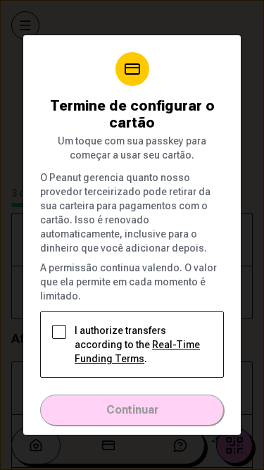

# Portuguese card-consent wording

The app copy changes “A Peanut gerencia” to “O Peanut gerencia” to follow the upstream brand glossary. Supplied funding terms are unchanged.

These captures render the actual app with synthetic fixture state, at 375 × 667, from signed private production builds. They are not provider E2E or native-device tests. The checkbox stays unchecked and Continue stays disabled; no consent or transaction is submitted. External requests are blocked. The source manifests and build IDs match before and after capture.

Before: `10ba4fe1321cb94fdffa33cf1df60b840f8a87d6`. After: `0bf32a30f3d848c96018027811a0b41f514c854b`.

| Before | After |
|---|---|
|  |  |
